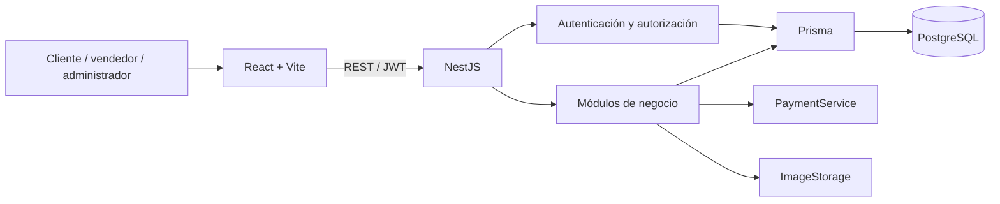

# Arquitectura propuesta

## Visión general

Un monolito modular NestJS atiende una SPA React a través de REST. PostgreSQL es la fuente de
verdad de usuarios, catálogo, pedidos e inventario. Prisma reside exclusivamente en el backend.
Separar frontend y backend permite desplegarlos independientemente sin acoplar sus dependencias.

## Organización

Frontend: `components`, `pages`, `layouts`, `services`, `hooks`, `store`, `types`, `schemas`,
`utils` y `routes`. TanStack Query administra datos remotos; Zustand conserva estado global pequeño.
React Hook Form y Zod validan formularios. El backend vuelve a validar todas las entradas.

Backend: módulos previstos `auth`, `users`, `businesses`, `products`, `categories`, `carts`, `orders`,
`inventory` y `admin`, junto a `common` y `config`. Cada módulo añadirá sus controllers, services y DTO
al implementarse. Controllers coordinan HTTP; services aplican reglas; Prisma maneja persistencia.
No se añadirán repositorios que simplemente dupliquen todos los métodos de Prisma.
Reseñas, promociones y notificaciones se agregarán posteriormente como módulos independientes.

## Flujo principal

1. Un usuario se registra como cliente o vendedor; el registro público nunca concede ADMIN.
2. Un vendedor crea su tienda en PENDING. Solo una tienda ACTIVE puede vender públicamente.
3. ADMIN aprueba o rechaza tiendas. SELLER administra exclusivamente su tienda.
4. CUSTOMER explora un catálogo paginado y agrega cantidades válidas al carrito.
5. Checkout recibe dirección y método de pago, y vuelve a leer productos y precios desde la BD.
6. La confirmación idempotente crea Order, SellerOrder CONFIRMED por tienda, líneas históricas,
   historial inicial y movimientos OUT; descuenta stock y vacía el carrito en una única transacción.
7. El cliente consulta su recibo e historial; cada vendedor consulta solo sus subpedidos.
8. El panel vendedor conecta métricas y productos en fase 15; la fase 16 añade estados e historial por tienda.

## Entidades conceptuales

El [modelo entidad-relación](data-model.md) detalla las decisiones de la fase 3 y su correspondencia
con el esquema Prisma y las restricciones SQL.

| Entidad            | Responsabilidad y relación principal                         |
| ------------------ | ------------------------------------------------------------ |
| User / Role        | Identidad y uno de tres roles iniciales; Role puede ser enum |
| Business           | Tienda de un propietario; ownerId único en el MVP            |
| Category           | Categoría global; parentId opcional para jerarquías futuras  |
| Product            | Producto de una tienda, categoría, precio y existencias      |
| ProductImage       | Imágenes ordenadas del producto                              |
| Cart / CartItem    | Carrito de cliente; una línea por producto                   |
| Order              | Compra global, cliente, dirección y total                    |
| SellerOrder        | Parte de la compra correspondiente a un negocio              |
| OrderItem          | Producto y valores históricos de la compra                   |
| Address            | Dirección guardada de usuario                                |
| InventoryMovement  | Entrada, salida o ajuste con stock anterior y posterior      |
| RefreshToken       | Sesión revocable con hash, expiración y familia de rotación  |
| OrderStatusHistory | Historial por subpedido, actor, fecha y transición           |

## Decisiones de consistencia y seguridad

- IDs opacos y slugs únicos; los IDs no sustituyen las verificaciones de autorización.
- Cada operación de vendedor aplica filtros de propiedad desde su identidad autenticada.
  No se acepta el businessId del cliente como prueba de pertenencia.
- Precios en decimal de precisión fija; moneda inicial GTQ. Las operaciones de dinero no deben
  depender de aritmética binaria de punto flotante. Se transportarán valores decimales explícitos.
- OrderItem conserva nombre, SKU y precio unitario; Order conserva una copia de la dirección.
  Editar un producto o una dirección guardada no altera compras históricas.
- Carrito y revisión no reservan existencias. Confirmar bloquea productos en orden estable,
  revalida disponibilidad y descuenta stock de todos los subpedidos atómicamente.
  Si falta inventario, toda la compra se revierte. La clave única por cliente evita duplicados.
- Se permiten PENDING → CONFIRMED → PREPARING → SHIPPED → DELIVERED. La cancelación será
  posible desde PENDING, CONFIRMED o PREPARING según actor; no desde SHIPPED ni DELIVERED.
  Solo se restaura stock previamente descontado, una vez, en la misma transacción.
- Estado global de Order se deriva de los subpedidos; una compra puede tener estados mixtos.
  No se usa un estado global para sobrescribir decisiones de distintos vendedores.
- Contraseñas bcrypt y refresh tokens con hash. Access JWT breve, refresh HttpOnly, rotación,
  revocación y protección mediante encabezado personalizado y origen.
- El cierre de sesión revoca la familia renovable. El guard JWT consulta usuario y familia activos
  en PostgreSQL en cada petición: logout, reutilización e inactivación deniegan el siguiente acceso.
  La rotación conserva el vencimiento absoluto; el frontend coordina una renovación
  en vuelo para evitar que peticiones simultáneas provoquen detección de reutilización.
- Validación DTO, CORS explícito, Helmet, límites de solicitudes y errores sin detalles internos.
- Se implementa pago contra entrega pendiente y simulado pagado como prueba, sin cobros reales;
  no se almacenan números de tarjetas.
  PaymentService permitirá proveedores futuros. ImageStorage permitirá almacenamiento local o remoto
  con validación de formato, tamaño y cantidad durante la implementación.

## API y experiencias

Base prevista: `/api/v1`. Recursos públicos de catálogo; `/auth`, `/cart`, `/orders`,
`/seller` y `/admin` para flujos específicos. Swagger documentará los contratos implementados.
Paginación y filtros se ejecutan en backend. Los datos de dashboards se calculan dentro de su ámbito.

Marketplace público comercial y visual; dashboard vendedor orientado a operaciones; dashboard
administrativo orientado a control. Diseño mobile-first, componentes reutilizables y estados
de carga, error, vacío y confirmación. Las rutas protegidas de React complementan los guards del backend.

## Estado de implementación

Frontend implementa React, rutas y formularios conectados. Backend tiene Prisma, API NestJS, herramientas de datos
y pruebas de integración; su tsconfig extiende `tsconfig.base.json`.
La fase 2 añade un contenedor PostgreSQL 17, volumen persistente, healthcheck y comprobación SQL.
La fase 3 añade el esquema Prisma, migración inicial con restricciones SQL y seed de categorías.
La fase 4 añade AppModule, DatabaseModule y HealthModule; configuración validada, errores HTTP,
ValidationPipe, CORS, Helmet y Swagger. La inyección de Prisma controla su ciclo de vida.
La fase 5 añade AuthModule y UsersModule: registro, login, JWT/Passport, refresh rotativos,
logout y perfil autenticado. Sus contratos y decisiones se detallan en [auth.md](auth.md).
La fase 6 añade guards globales de JWT y roles, excepciones públicas explícitas, filtros Prisma
de propiedad, límites de solicitudes y de tamaño JSON. El rol y la sesión se consultan en BD.
La fase 7 añade BusinessesModule: creación, consulta y edición de la tienda propia con filtros
de propietario dentro de las consultas, además de lista pública paginada y detalle por slug.
La consulta pública exige tienda ACTIVE y propietario SELLER activo; usa una proyección explícita.
Las fases 15–17 incorporan paneles y gestión de estados sobre estos controles de propiedad.
Consulta [negocios](businesses.md) para contratos, visibilidad y pruebas reales del módulo.
La fase 8 añade CategoriesModule: administración global exclusiva de ADMIN y consulta pública
paginada de categorías activas. Desactivar conserva referencias; el seed no sobrescribe ediciones.
La API mantiene categorías planas y reserva parentId para subcategorías posteriores.
Consulta [categorías](categories.md) para contratos y pruebas del módulo.
La fase 9 añade ProductsModule: CRUD acotado al vendedor, inventario transaccional y carga de imágenes.
ImageStorage desacopla la persistencia; LocalImageStorage usa archivos WebP con nombres generados.
Los archivos se sirven por controllers que comprueban propietario o visibilidad comercial, sin
exponer el directorio de uploads. Detalles de normalización y compensación en [productos](products.md).
La fase 10 añade una SPA con portada, autenticación, cuenta y edición de tienda propia.
Los contratos Zod, Axios y Zustand residen en services; TanStack Query conserva datos remotos.
El token se guarda en memoria, refresh usa la cookie HttpOnly y Web Locks coordina pestañas.
Los guards de React mejoran navegación; NestJS mantiene los controles efectivos de acceso.
Detalles de proxy, rutas y pruebas en [frontend](frontend.md).
La fase 11 añade consultas públicas de productos con proyección explícita y un filtro compartido
con la media pública. Conteo y datos se leen secuencialmente dentro de RepeatableRead.
React incorpora catálogo, filtros por URL, directorio, tienda pública y galería de producto.
Axios público funciona sin token ni renovación de sesión; las páginas se cargan bajo demanda.
Detalles en [marketplace](marketplace.md).
La fase 12 añade CartsModule para CUSTOMER, persistencia propia y totales decimales por negocio.
Un bloqueo transaccional por cliente serializa las escrituras; no se reserva inventario.
El frontend usa Axios privado, caché por identidad y mutaciones del carrito serializadas.
Precios y disponibilidad se recalculan; líneas inválidas se conservan para corregir/eliminar sin filtrar datos privados.
Detalles en [carrito](cart.md).
La fase 13 añade CheckoutModule para validar entrega y revisar el carrito con precios actuales.
PaymentService prepara contratos de contra entrega/simulación sin cobrar ni marcar PAID.
La revisión no persiste dirección ni cambia inventario; los datos de entrega permanecen locales
en React durante esa visita. Los resúmenes quedan invalidados al editar o cambiar el carrito.
Detalles en [checkout](checkout.md).
La fase 14 añade OrdersModule, confirmación CUSTOMER y lectura propia CUSTOMER/SELLER.
Se guardan snapshots de producto y entrega, historial inicial y salidas de inventario en una transacción.
Una migración añade idempotencia; reviewVersion detecta cambios respecto a la revisión.
React incorpora recibos, historial y recuperación de un intento incierto mediante GET, sin repetir la compra.
Detalles en [pedidos](orders.md). El dashboard vendedor y las transiciones se incorporan en fases 15 y 16.
La fase 15 añade SellerDashboardModule con métricas del negocio autenticado en RepeatableRead.
React conecta listado, filtros y CRUD de productos, ajustes de stock e imágenes privadas al panel.
Las sumas históricas usan subtotales propios y separan simulación de contra entrega; no representan cobros.
No modifica esquema ni dependencias. Detalles en [panel vendedor](seller-dashboard.md).
La fase 16 añade OrderTransitionsService con autorización por actor, estado esperado e historial atómico.
Los bloqueos siguen el orden del inventario y la cancelación repone una sola vez sin reactivar moderación.
React conecta acciones revisables, recuperación tras resultados inciertos e historial por tienda.
Los totales y pagos históricos se conservan; no se ejecutan cobros ni reembolsos.
Detalles en [gestión de pedidos](order-management.md).
La fase 17 añade AdminModule para métricas globales y revisión de tiendas con versión esperada.
La aprobación exige propietario SELLER activo; la suspensión usa las reglas comerciales existentes.
Las sumas Decimal globales usan partes no canceladas por método y no se confunden con cobros.
React incorpora resumen y revisión ADMIN con segundo paso y recuperación por consulta.
El propietario aprovisiona cuentas ADMIN nuevas mediante utilidad local; el seed y registro público
no conceden ese rol. Sin nueva migración ni dependencia. Detalles en [panel administrador](admin-dashboard.md).
Consulta [seguridad](security.md) para la política de roles, propiedad y cuotas por IP.
Consulta [la guía del backend](backend.md) para iniciar y comprobar la API.
Consulta [la guía de base de datos](database.md) para operar el entorno.
