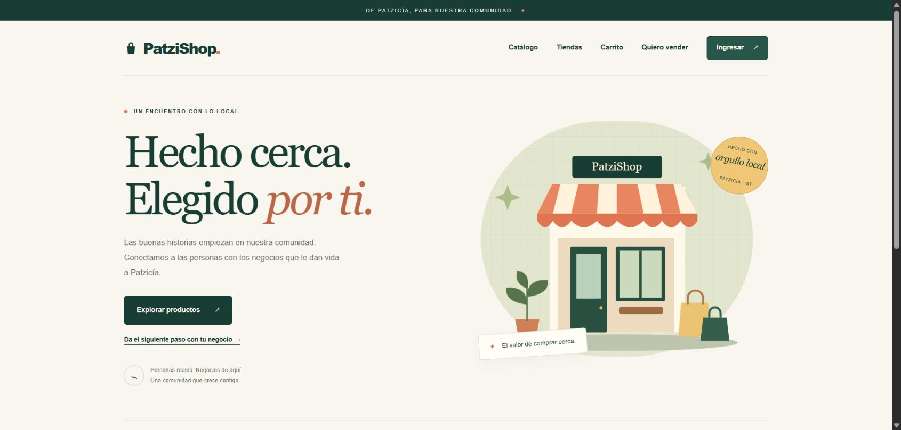
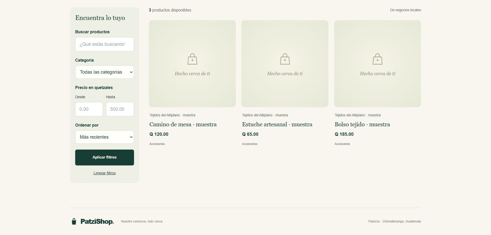
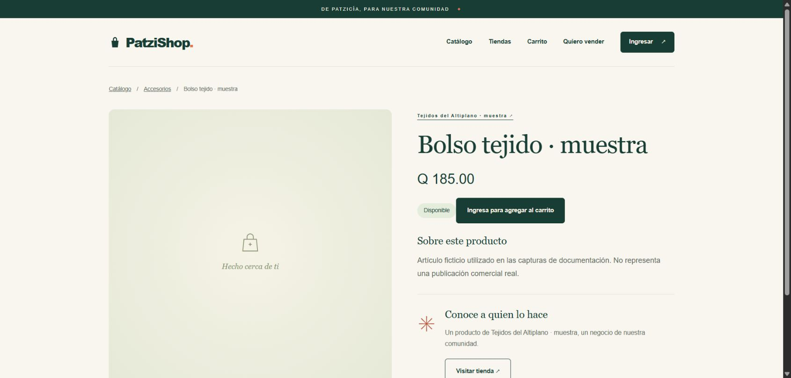
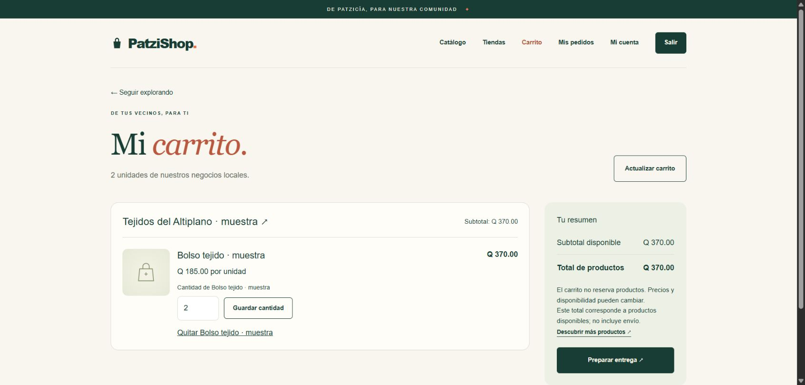
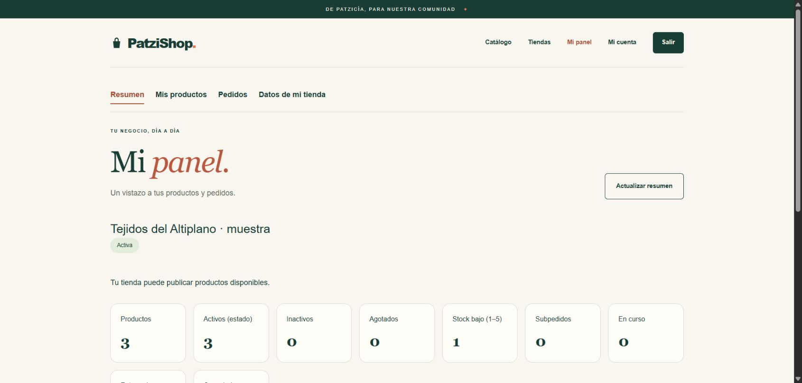
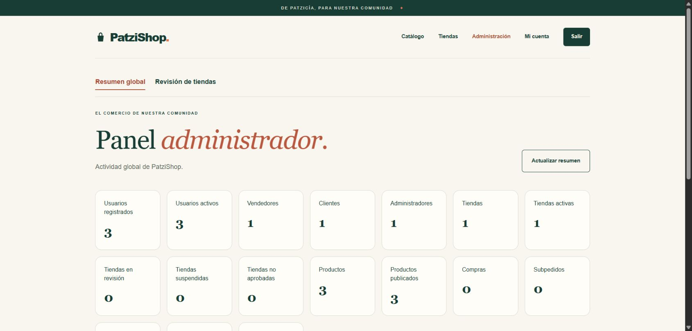

# Capturas de la aplicación

Capturas reales tomadas el 2026-10-26 en Brave, usando frontend de desarrollo y API NestJS
contra una base exclusiva de documentación. No son maquetas ni imágenes generadas. Los nombres,
productos, contactos e importes son ficticios y llevan «muestra»; no representan ventas reales.
No se publican credenciales ni datos de una base de usuario. Las fixtures no forman parte del seed.

Los productos de muestra carecen de fotografías: se ve el placeholder real de PatziShop.
El carrito contiene dos unidades a Q 185.00 (Q 370.00); los paneles no tienen pedidos ni cobros.
Las imágenes muestran estados concretos, no prueban todos los flujos ni sustituyen las pruebas.

## Inicio

Portada pública con la identidad visual implementada.

## Catálogo en escritorio

Vista desplazada hasta filtros, tres productos, sus tiendas y precios. Se conservó el viewport
normal del navegador; la captura muestra el contenido visible, no una composición de pantallas.

## Producto

Detalle público con descripción de muestra, precio e ingreso requerido para añadir al carrito.

## Carrito de cliente

Cuenta CUSTOMER ficticia; cantidades y resumen obtenidos de la API, sin confirmar una compra.

## Panel vendedor

Negocio ficticio ACTIVE, tres productos y uno con stock bajo. Los importes de pedidos son cero.

## Administración

Cuenta ADMIN exclusiva de captura; métricas reales de la base ficticia, sin ingresos ni pedidos.

## Vista móvil

Se solicitó un viewport de 390 × 844. Con la escala del navegador, la página informó 434 × 938
CSS, clientWidth=417 y scrollWidth=417: sin desborde horizontal en esa observación. Es emulación,
no una prueba en dispositivo físico. La exportación de imagen falló por timeout de captura;
no se incluye una captura móvil. Se retiró el override y se cerró la pestaña de trabajo.
Las seis imágenes anteriores son las capturas efectivamente obtenidas y revisadas.

## Repetir una sesión de captura

Preparar una base vacía independiente y aplicar migraciones/seed según [instalación](installation.md).
Crear únicamente fixtures identificables y ficticias, y usar credenciales aleatorias no versionadas.
Se pueden preparar relaciones directamente en esa base de captura: no equivalen a demostrar el flujo
HTTP de aprobación o compra. Iniciar frontend/API con esa conexión; esperar la carga antes de capturar.

Revisar que no haya formularios con contraseñas, tokens, cookies, direcciones reales, devtools ni datos
de terceros visibles. Guardar solo capturas finales en docs/screenshots; archivos intermedios van a tmp.
Cerrar sesiones, retirar fixtures y servidores propios al terminar. No eliminar bases o datos ajenos.
Los recorridos funcionales y las verificaciones del stack se registran en [testing](testing.md) y [Docker](docker.md).
